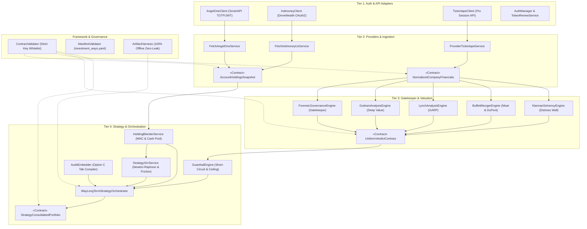

# System Architecture & Design Documentation
**Repository:** `tickertape-indmoney-tracking`  
**Framework Specification:** `AID-BMAD-MODULAR-STOCK-V1`  
**Author:** Antigravity Architecture Engine  
**Last Updated:** November 2026

---

## 1. Directory Structure

All architectural and system design diagrams are maintained in this `design/` folder in standard **Draw.io (`.drawio`) XML** format, which can be opened natively in [diagrams.net (Draw.io)](https://app.diagrams.net/), the VS Code Draw.io extension (`hediet.vscode-drawio`), or the Draw.io desktop application.

```
design/
├── README.md                      # Comprehensive architectural documentation & diagram walkthroughs
├── architecture_master.drawio     # Master 4-page tabbed workbook containing all diagrams
├── activity_diagram.drawio        # End-to-end activity workflow & data processing pipeline
├── component_class_diagram.drawio # Multi-tier subsystem component & canonical data contract model
├── use_case_diagram.drawio        # System actors, subsystem boundaries & use case specifications
├── sequence_diagram.drawio        # Time-ordered execution sequence of Tier 4 strategy orchestration
└── generate_drawio_diagrams.js    # Automated deterministic generator script for all Draw.io diagrams
```

---

## 2. Architecture Overview & Tier Model

The system follows a strict **4-Tier Modular Investment Architecture** with an overarching **Governance & Verification Framework**:



---

## 3. Diagram Walkthroughs

### 3.1. Activity Diagram (`activity_diagram.drawio`)
**File:** [`activity_diagram.drawio`](./activity_diagram.drawio)  
**Page Title:** `End-to-End Activity Workflow`

#### Purpose & Scope:
Captures the complete dynamic execution flow and data transformations from the moment an investor or CLI runner triggers `node way_long_term_strategy.js --way fundamental_lts` until twin self-contained reports are delivered.

#### Key Stages & Swimlanes:
1. **Investor / CLI Interface Lane:** Initiates orchestration commands and receives master HTML/JSON outputs.
2. **Framework Lane (Step 0):** Validates `config/investment_ways.yaml` using `manifest_validator.js`. Halts immediately on schema errors.
3. **Tier 1 & Tier 2 Ingestion Lanes (Fork / Parallel Ingestion):**
   - **Branch A:** Angel One SmartAPI TOTP login -> Fetch Demat lots & cash -> emit `AccountHoldingsSnapshot` (`angelone.json`).
   - **Branch B:** INDmoney / DriveWealth OAuth2 refresh -> Fetch US equities & USD cash -> fetch USD/INR live FX -> emit `AccountHoldingsSnapshot` (`indmoney_us.json`).
   - **Branch C:** Tickertape Pro session -> Ingest quotes, P&L, Balance Sheet, Cash Flow, Forensics -> normalize to `NormalizedCompanyFinancials` (`<TICKER>.json`).
4. **Tier 4 Holding Blender:** Blends multi-account holdings, calculates Weighted Average Cost (WAC), pools multi-currency cash balances with FX conversion, and preserves lot-level attribution tranches (`StrategyHoldingsBlended`).
5. **Tier 4 Strategy XIRR & Friction Tracker:** Aggregates bank deposits, withdrawals, and dividends, cancels internal broker transfers, solves annualized XIRR via Newton-Raphson, and itemizes friction drag (brokerage, STT, currency spread, taxes).
6. **Tier 3 Forensic Governance Gatekeeper:** Evaluates promoter pledging, auditor stability, Beneish M-Score, and Sloan accrual ratios.
   - **Gatekeeper Short-Circuit Branch:** If `VETO_DISQUALIFIED`, immediately forces target allocation to `0.0%`, stamps stance as `DISQUALIFIED`, and updates the executive Disqualified Alert banner.
7. **Tier 3 Valuation Engines (Parallel Execution):**
   - *Benjamin Graham:* NNWC, NCAV, Graham Number Floor, Margin of Safety.
   - *Peter Lynch:* PEG ratio, yield-adjusted PEG, inventory-to-sales velocity divergence, lifecycle archetype.
   - *Buffett & Munger:* True Owner Earnings ($CFO - CapEx - SBC$), 5-step DuPont ROE decomposition, ROIC economic moat.
   - *Seth Klarman:* Altman Z-Score, Net Debt/EBITDA leverage, 24-month debt maturity cliff exposure.
8. **Tier 4 Guardrail Engine:** Evaluates the **Asymmetric Downside Guardrail** (any `STRONG_SELL` flips stance to `NEEDS_REVIEW`), enforces ceiling capping (Gatekeeper `FLAG` caps at `HOLD`), and computes weighted principle scores.
9. **Stage 5 Option C Assembly & Framework Verification:** Embeds all 5 Tier 3 audits into tabbed HTML models, verifies top-level schema keys with `contract_validator.js`, audits 100% offline self-containment with `artifact_harness.js` (zero CDN/font/script leaks), and writes `way_long_term_strategy.json` and `way_long_term_strategy.html`.

---

### 3.2. Component & Class Diagram (`component_class_diagram.drawio`)
**File:** [`component_class_diagram.drawio`](./component_class_diagram.drawio)  
**Page Title:** `Component & Class Architecture Diagram`

#### Purpose & Scope:
Presents both the architectural component packages and the detailed UML class/data-contract model, showing module dependencies, method signatures, attributes, and relationships.

#### Subsystem Packages & Classes:
- **`pkg_tier1` (Auth & API Clients):**
  - `AuthManager`: Singleton handling encrypted credential decryption, OAuth2 token renewal, and session validation.
  - `AngelOneClient`: SmartAPI adapter with TOTP PIN login, Demat holding parser, and RMS cash limits.
  - `IndmoneyClient`: DriveWealth REST client for US fractional holdings, USD ledger, and FX rates.
  - `TickertapeClient`: Private Pro API client with 24-hour statement caching and ratio scrapers.
- **`pkg_tier2` (Providers & Ingestion):**
  - `FetchAngelOneService`: Produces `AccountHoldingsSnapshot`.
  - `FetchIndmoneyUsService`: Produces `AccountHoldingsSnapshot`.
  - `ProviderTickertapeService`: Produces `NormalizedCompanyFinancials`.
  - `AccountHoldingsSnapshot` & `NormalizedCompanyFinancials`: Canonical data contracts.
- **`pkg_tier3` (Gatekeeper & Valuation Analysis Engines):**
  - `ForensicGovernanceEngine`: Gatekeeper evaluation yielding `PASS`, `FLAG`, or `VETO_DISQUALIFIED`.
  - `GrahamAnalysisEngine`, `LynchAnalysisEngine`, `BuffettMungerEngine`, `KlarmanSolvencyEngine`: Principles emitting `STRONG_BUY`, `BUY`, `HOLD`, `REDUCE`, `STRONG_SELL`.
  - `UniformVerdictContract`: Canonical schema with confidence score, metric breakdown, and audit payload.
- **`pkg_tier4` (Strategy Orchestrators & Risk Synthesis):**
  - `HoldingBlenderService`: Computes position blending and WAC.
  - `StrategyXirrService`: Numerical Newton-Raphson solver with sub-90-day guardrails and friction tracking.
  - `GuardrailEngine`: Enforces downside short-circuits and ceiling rules.
  - `AuditEmbedder`: Serializes complete audit models for interactive Option C tab switching.
  - `WayLongTermStrategyOrchestrator`: Coordinates the 5-stage pipeline.
  - `StrategyConsolidatedPortfolio`: Canonical master data contract.
- **`pkg_framework` (Cross-Cutting Framework & Governance):**
  - `ContractValidator`: Validates JSON contracts against draft-07 schemas and whitelisted top-level keys (`FINANCIALS_TOP_KEYS`).
  - `ManifestValidator & YamlLoader`: Enforces 1-to-many account partitioning and weight normalization.
  - `ArtifactHarness`: Guarantees 100% offline self-containment with zero external network leaks.

---

### 3.3. Use Case Diagram (`use_case_diagram.drawio`)
**File:** [`use_case_diagram.drawio`](./use_case_diagram.drawio)  
**Page Title:** `System Use Case Diagram (Strictly Vertical Pipeline)`

#### Layout Specification:
- **Strictly Vertical Flow:** All 4 subsystems are stacked vertically one after another down the Y-axis.
- **Single-Column Use Cases:** Within each subsystem, use cases are positioned strictly one after another in a single centered column (`x=95, width=430, height=65`), with dependency relationships (`«extend»`, `«include»`) routed along the inner left and right boundary channels to maintain clean line separation.

#### Actors:
- **Retail / Strategic Investor (Human Actor):** Reviews executive KPI metrics, inspects blended holdings with lot attribution, audits individual valuation principles in interactive tabs, and checks friction drag.
- **Autonomous Strategy Agent / CLI Runner (System Actor):** Executes unattended or scheduled strategy pipelines, triggers token refreshes, runs batch audits, and generates artifacts.
- **External Broker APIs:** `Angel One SmartAPI`, `INDmoney / DriveWealth API`, `Tickertape Pro Private API`.
- **System Boundary / File System:** Offline reports and JSON cache store.

#### Core Subsystem Boundaries & Use Cases (4 Vertical Subsystems):
1. **Subsystem 1: Stock Accounts System (Top):**
   - `UC1`: Authenticate Broker APIs (Angel One TOTP/JWT, INDmoney OAuth2)
   - `UC2`: Renew Expired Session Tokens (`<<extend>>` on 401/403)
   - `UC3`: Fetch Angel One Demat Positions & Ledger Cash Balances
   - `UC4`: Fetch INDmoney US Equities, Fractional Lots & USD Cash
   - `UC5`: Fetch Live USD/INR Exchange Rate (`<<include>>` in UC4)
   - `UC6`: Persist Account Holdings Snapshot Artifacts (JSON & HTML) (`<<include>>` in UC3 & UC4)
2. **Subsystem 2: Stock Info Provider (Placed After Subsystem 1):**
   - `UC7`: Ingest Fundamental Statements & Historical Financial Ratios (Tickertape Pro)
   - `UC8`: Validate 24-Hour Cache & Support `--refresh` Flag (`<<extend>>`)
   - `UC9`: Normalize Statements into Canonical Company Financials Contract (`<<include>>` in UC7)
   - `UC10`: Validate Strict Top-Level Financials Schema Keys (`<<include>>` in UC9)
   - `UC11`: Emit Financials Contract & Visual Audit Dashboard HTML (`<<include>>` in UC9)
3. **Subsystem 3: Stock Analysis System (Placed After Subsystem 2):**
   - `UC12`: Forensic Governance Audit (Promoter Pledge, Beneish M-Score, Sloan Accruals)
   - `UC13`: Benjamin Graham Deep Value (NNWC, NCAV, Graham Number Floor, Margin of Safety)
   - `UC14`: Peter Lynch GARP Analysis (PEG Ratio, Lifecycle Archetype, Inventory Divergence)
   - `UC15`: Buffett-Munger Moat Analysis (Owner Earnings, 5-Step DuPont ROE, ROIC Moat)
   - `UC16`: Seth Klarman Solvency Stress (Altman Z-Score, Net Debt/EBITDA, Debt Cliff 24M)
   - `UC17`: Emit Uniform Verdict Contract & Self-Contained Pillar HTML (`<<include>>` in UC12-UC16)
4. **Subsystem 4: Portfolio Analysis System (Placed After Subsystem 3):**
   - `UC18`: Blend Multi-Account Holdings with WAC & Pooled FX Cash
   - `UC19`: Compute True Strategy XIRR & Itemize Friction (Newton-Raphson, STT, Brokerage, FX Spread, Taxes)
   - `UC20`: Short-Circuit Vetoed Stocks (0.0% Allocation & Disqualified) (`<<extend>>` on `VETO_DISQUALIFIED`)
   - `UC21`: Synthesize Weighted Stance & Enforce Downside Guardrails (`<<include>>` ceiling capping)
   - `UC22`: Compile Consolidated Portfolio Contract (`StrategyConsolidatedPortfolio`)
   - `UC23`: Embed Complete 5-Pillar Audits into Interactive Option C Tabs (`<<include>>` in UC22)
   - `UC24`: Render 100% Offline Master HTML Dashboard with Hero KPIs & Friction Waterfall (`<<include>>` in UC22)
   - `UC25`: Audit Zero External Leaks & Offline Self-Containment (`<<include>>` in UC24)

---

### 3.4. Sequence Diagram (`sequence_diagram.drawio`)
**File:** [`sequence_diagram.drawio`](./sequence_diagram.drawio)  
**Page Title:** `End-to-End Orchestration Sequence Diagram`

#### Lifelines:
1. `User / CLI`
2. `:WayOrchestrator` (`Tier 4`)
3. `:ManifestValidator` (`Framework`)
4. `:FetchAngelOne` (`Tier 2`)
5. `:FetchIndmoneyUs` (`Tier 2`)
6. `:HoldingBlender` (`Tier 4`)
7. `:StrategyXirr` (`Tier 4`)
8. `:ProviderTickertape` (`Tier 2`)
9. `:ForensicGov` (`Tier 3 Gatekeeper`)
10. `:ValuationEngines` (`Tier 3 Principles`)
11. `:GuardrailEngine` (`Tier 4`)
12. `:AuditEmbedder` (`Tier 4`)
13. `:ArtifactHarness` (`Framework`)
14. `:FileSystem` (`Reports`)

#### Sequence Highlights:
- **`par` Fragment:** Parallel broker Demat ingestion (`FetchAngelOne` and `FetchIndmoneyUs`).
- **Holding Blending:** Blends INR and USD positions, calculating WAC and pooling cash.
- **Strategy XIRR:** Aggregates bank cashflows and solves Newton-Raphson.
- **`loop` Fragment:** Loops through every holding symbol in the consolidated portfolio.
- **Gatekeeper Evaluation:** Runs `ForensicGov` before any valuation engines.
- **`alt` Fragment:**
  - *If `VETO_DISQUALIFIED`:* Short-circuits directly to `GuardrailEngine` setting allocation to `0.0%`.
  - *Else (`PASS` / `FLAG`):* Triggers `par` fragment executing all 4 valuation principles in parallel.
- **Option C Embedding:** `AuditEmbedder` maps raw verdict payloads into tab JSON models.
- **Self-Containment & Contract Verification:** Validates JSON schema and checks HTML for zero external URLs (`http://` / `https://`).
- **Disk Persistence:** Writes `reports/strategies/fundamental_lts.json` and `.html`.

---

## 4. Master Multi-Page Architecture Workbook (`architecture_master.drawio`)
**File:** [`architecture_master.drawio`](./architecture_master.drawio)

The master workbook integrates all 4 diagrams into a single cohesive project file with multi-page tabs:
1. **Page 1:** `Component & Class Architecture Diagram`
2. **Page 2:** `End-to-End Activity Workflow`
3. **Page 3:** `System Use Case Diagram`
4. **Page 4:** `End-to-End Orchestration Sequence Diagram`

---

## 5. How to View and Edit the Diagrams

### Option A: VS Code (Recommended)
1. Install the official VS Code extension: **Draw.io Integration** (`hediet.vscode-drawio`).
2. Open any `.drawio` file in `design/`. It will render directly as an interactive vector canvas inside VS Code.
3. You can switch tabs in `architecture_master.drawio` via the bottom tab bar.

### Option B: diagrams.net (Web Browser)
1. Navigate to [https://app.diagrams.net/](https://app.diagrams.net/).
2. Select **Open Existing Diagram** and pick any file from the `design/` folder.
3. Edit nodes, connections, and layouts, and export as SVG, PNG, or PDF as required.

### Option C: Re-generating Diagrams Programmatically
The diagrams are generated using:
```bash
node design/generate_drawio_diagrams.js
```
This ensures reproducible, mathematically aligned diagrams that stay in sync with future architectural changes.

